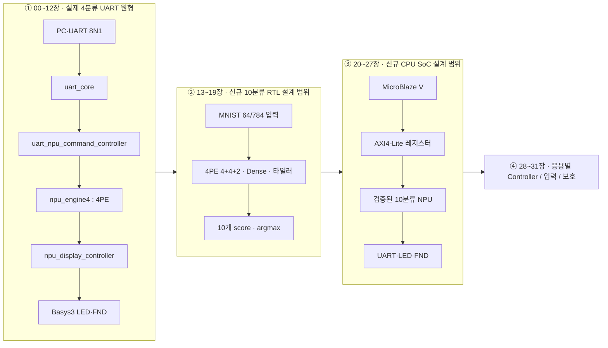

# 제3부 00~31장 — 누적형 실습·보드 확인 운영 기준

> 제3부는 32개의 독립 프로젝트가 아니라 **3개 누적 시스템 + 4개 응용 분기**로 운영한다. 준비 00장과 정규 01~31장 구성은 유지한다. 32장 이후는 다루지 않는다.
>
> 본 문서는 작업 절차의 설계 기준이다. RTL 시뮬레이션, 합성, 구현, bitstream, 보드 성공을 대체하지 않는다. 해당 결과는 실행 환경·commit SHA·파일 경로와 함께 기록한다.

## 1. 네 가지 구성 원칙

1. **체계화** — 각 장을 동일한 체계 `이전 산출물 → 이번 장 추가 → 소스/인터페이스 → 실행 절차 → 확인 기준 → 다음 장 인계`로 정리한다.
2. **순서화** — 코드 확인, 단위 TB, Python 정답 대조, 통합 TB, Vivado 합성/구현, Bitstream, 실제 보드, 회귀 검증을 구분한다. 장별로 수행되지 않은 게이트는 해당 없음/미검증으로 기록한다.
3. **구조화** — 공통 연산 RTL, UART, AXI 래퍼, SoC, 응용 Controller를 분리한다. 최상위 Top은 보드 연결·wire·인스턴스만 둔다.
4. **시각화** — 각 장에 이전/추가/출력 블록과 신호명, 주요 상태전이, 예상 보드 출력의 위치를 실제 코드 기준으로 정리한다. 구현되지 않은 연결은 **설계 개념도**로 표시한다.

## 2. 누적 프로젝트 경계

| 구간 | 기준 작업 폴더 | 다음으로 넘기는 완성 단위 | 기존 작업 보존 |
|---|---|---|---|
| 00~12 | 실제 `part03/mini_npu/` + `common/` + 원본 `ch01~ch10/` | `basys3_npu_top.v`, `npu_engine4.v`, UART/RX/TX, DSP 누산·LED/FND | 이미 존재하는 성공 원형 유지 |
| 13~19 | **예정** `part03/npu10/` (로컬 작업물이 있으면 이름/소스 실제 확인 후 채택) | 10클래스 4PE, 64/784입력, 정수 Dense/MLP, 타일 누산, 정밀도 | 기존 4분류 원형과 독립 빌드 |
| 20~27 | **예정** `part03/soc_npu/` (새 독립 Vivado 프로젝트) | 10클래스 코어에 AXI4-Lite·MicroBlaze V·Vitis SW 연결 | 제1부 `soc11` 성공 XPR을 직접 수정하지 않음 |
| 28~31 | **예정** `part03/capstones/` 아래 응용 분기 | 공통 SoC+각 응용 Controller/입출력·안전/보안 | 27장 기준선 복사/참조 후 응용 간 오염 방지 |

각 장별 `chNN/` 폴더를 반드시 독립 Vivado XPR로 만들지 않는다. **실제 공유 RTL·프로젝트는 단계 폴더에서 누적**, 차시 폴더는 관련 코드/검증/설명에 연결한다. 기존 로컬 경로와 모듈명이 다르면 사용자 코드의 실제 경로를 기준으로 매핑한다.

## 3. 하드웨어 연결의 누적 데이터 흐름

**도식 상태:** S1은 GitHub RTL 존재/로컬 시뮬레이션 기록 존재, 실제 보드는 별도 미검증. S2/S3/응용은 현재 GitHub에 통합 RTL·BD·Vitis 실물이 게시되지 않은 설계 목표다. 이 그림의 S1→S2/S2→S3는 소스 재사용·개발 흐름이며 실제 배선 직결을 뜻하지 않는다.

## 4. 00~12장 — 최초 재현 가능한 Basys3 확인

**기존 파일:** `part03/mini_npu/scripts/build_vivado.tcl`, `part03/mini_npu/constraints/basys3_npu.xdc`, `basys3_npu_top.v`. 
**보드:** Basys3 XC7A35T, 100 MHz W5, BTNC 리셋 U18, USB UART RX B18 / TX A18, LED/FND는 XDC에 지정된 내장 핀 사용.

1. `bash part03/mini_npu/scripts/run_batch_00_12.sh` 및 `run_adversarial.sh`의 실제 로그를 확인한다.
2. `bash part03/mini_npu/scripts/run_vivado_synth.sh`로 **별도** `part03/mini_npu/build/` 프로젝트를 만든다. 이 스크립트는 **합성만 수행**하며 Bitstream이 아니다.
3. Vivado GUI에서 해당 `p3_uart_npu.xpr`를 연다. `Run Implementation` → Timing/DRC 확인 → `Generate Bitstream` 순서로 진행한다. 실패하면 보드 게이트로 넘어가지 않는다.
4. 보드를 USB-JTAG/UART로 연결한다. `Open Hardware Manager` → `Open Target` → `Auto Connect` → `Program Device`에서 실제 생성한 bitstream을 선택한다.
5. Ubuntu에서 `ls -l /dev/serial/by-id/`로 포트를 확인한 뒤 `minicom -D /dev/ttyUSB0 -b 115200 -8`과 같은 방식으로 접속한다(장치명은 예시; 실제 포트에 맞춰 변경). UART 8N1, 흐름 제어 끔.
6. 단일 문자 `0`, `1`, `2`, `3`을 차례로 전송한다. 기대 클래스는 0,1,2,3이며 응답 형식은 `Ck:...` + CRLF. 해당 클래스 LED0~3 중 하나가 켜지고 FND 한 자리에 클래스가 표시되는지 확인한다. `LED14`는 DONE 래치, `LED15`는 ERROR 래치; BTNC는 리셋이다.
7. 시험 입력/예상 점수/실제 UART 수신/LED/FND 관측/파일 SHA를 별도 실물 기록으로 남긴다. **현재 저장소에는 보드 성공 증거가 없으므로 성공으로 표기하지 않는다.**

**주의:** `X/W/B/R`은 ASCII 텍스트가 아니라 바이너리 페이로드가 필요하므로 일반 터미널의 문자 입력과 혼동하지 않는다. `0~3`은 이 4분류 예제 전용이다.

## 5. 13~19장 — 10분류 단계별 누적·실물 경계

| 장 | 유지/이어받기 | 이번 장에 추가 | 실제 확인/인계 조건 |
|---|---|---|---|
| 13 | 12장 UART/BRAM 개념, Python MNIST 8×8 입력 | 64원소 INT8/16 입력 계약·정확한 스케일 | PC 벡터→입력 RAM, RTL 시뮬레이션에서 64주소 읽기 확인; 10분류 보드 표시를 아직 기대하지 않음 |
| 14 | 13장 64입력, 기존 4PE 설계 | 4+4+2 그룹 제어·10 score 보관·signed argmax | 0~9 모두 한 번씩 결과 확인; 마지막 2차선 무효; RTL 후 10분류 보드 경로 통합 |
| 15 | 14장 10 score/스케줄 | signed Dense 64→10 가중치/Bias 저장·검증; 16장용 64→8, 8→10 재사용성 확보 | Python `linear_64x10`와 10개 결과 동일; 코어 중복 재작성 금지 |
| 16 | 15장 Dense 공통 자산 | 은닉 8→ReLU→정수 양자화→출력 10; 단계별 valid/ready | Python `mlp_64_8_10`와 은닉/최종 출력 비교 |
| 17 | 14~16장 64원소/10클래스 | 784원소 13타일(64×12+16), **코어 밖에서 타일별 부분합 누산** | Python `dot_tiled_64`와 동일; Bias 전체 누산 후 1회; 타일 순서/마지막 16개 검증 |
| 18 | 17장 타일러, 15/16장 Dense | 같은 모델 Float32 vs INT8/INT16, 포화/반올림 및 데이터 폭 설정 | 동일 실제 MNIST 시험셋 정확도/혼동행렬은 PC; RTL 정수 결과 각각 비교. 784항 + 40비트 Bias 최악 범위는 signed 42비트 이상 검토 |
| 19 | 14~18장 검증 NPU | 1/4/8PE 배치안, 처리 사이클·BRAM 포트·단가 비교 | 파형으로 사이클 계산; DSP/BRAM/LUT/FF 실제 숫자는 Vivado 보고서에서만 기록 |

**실물 10분류 통합 게이트:** 13~19장에서 공통 코어와 실제 PC↔UART/SoC↔Class0~9 출력 경로가 준비된 후 수행한다. 기존 12장 비트스트림으로는 10분류를 확인할 수 없다. 테스트용 프로토콜·LED/FND 표시 코드는 신규 컨트롤러에서 정하고 실제 RTL과 일치시킨다. 보드 단계의 필수 순서는 **테스트벡터 기록 → 입력/가중치 적재 → 실행 → DONE → UART 점수·클래스 수신 → LED/FND 대조 → Reset 재시험**이다.

## 6. 20~27장 — AXI/CPU 통합 단계별 누적·보드 절차

| 장 | 유지/이어받기 | 이번 장에 추가 | 다음 장 인계 |
|---|---|---|---|
| 20 | 19장 검증된 연산 Core | AXI4-Lite Slave 래퍼 및 CTRL/STATUS/LENGTH/CLASS 등 Register Map | 별도 AXI TB에서 AW/W 독립, WSTRB, B/R 역압력 확인 |
| 21 | 20장 AXI IP + 제1부 MicroBlaze V SoC 지식 | **독립** Vivado 프로젝트/BD, Clock/Reset, AXI 연결, 주소 배치 | Validate Design·Address Editor·소스/Port/XDC 일치 |
| 22 | 21장 XSA, `xparameters.h` 주소 | Vitis 드라이버: 데이터/모델 적재, START, DONE/ERROR, CLASS/Score | 실제 BSP 주소 반영, ELF/프로그램과 H/W 일치 |
| 23 | 22장 CPU/NPU 경로 | 동일 데이터/모델 기준 CPU vs NPU 실행 시간 | CPU/NPU 실행 시간 측정 로그 |
| 24 | 23장 동일 Vivado 빌드 | DSP/BRAM/LUT/FF, WNS/TNS 및 Critical Path | 합성/구현 리포트·빌드 SHA |
| 25 | 24장 구현 | 동일 switching/clock 조건에서 추정 전력/에너지 | 전력 도구의 설정·가정 및 Report 분리 |
| 26 | 25장 NPU/AXI 기준선 | 3×3 소형 CNN 연산 경로 독립 확장 | 기존 NPU 회귀 및 새 CNN TB |
| 27 | 20~26장 통합 | CPU→AXI→10분류 NPU→UART/LED/FND 최종 시스템 | 보드에서 0~9 입력/점수/표시 재현, 28~31장 분기 기준선 |

**실제 GUI 순서:**

1. 제1부 **성공 XPR을 열어 `File → Project → Save As`로 독립 프로젝트에 복제**한다. 이전 성공 프로젝트를 이동·덮어쓰기하지 않는다.
2. 20장에서 별도 검증한 사용자 AXI IP를 `Tools → Create and Package New IP` 경로로 추가/패키징한다. IP 저장소 등록 후 인스턴스 생성.
3. `Block Design`에서 MicroBlaze V, AXI Interconnect/SmartConnect, NPU IP, Clock/Reset 및 인터럽트를 **실제 IP 포트** 기준으로 연결한다. 레지스터/인터페이스 이름을 자동 생성 예제와 억지로 일치시키지 않는다.
4. `Address Editor`에서 NPU BASEADDR을 배치하고 실제 주소를 기록한다. `Validate Design` 후 `Generate Output Products`/Wrapper, Top/XDC 확인.
5. `Run Synthesis` → `Run Implementation` → WNS/TNS·DRC → `Generate Bitstream`; 오류 해결 전에는 BOARD로 넘어가지 않는다.
6. `Export Hardware` 또는 사용 Vivado 버전의 `Export Hardware/XSA`에 Bitstream을 포함하고 Vitis Platform으로 가져온다. `xparameters.h`와 C 코드의 BASEADDR을 대조한다.
7. Vitis Application Build 후 실제 ELF를 실행한다. PC에서 전송한 같은 샘플의 Python 점수·CLASS와 Vitis UART 로그·LED/FND 출력이 일치하는지 확인한다.
8. `Reset`, 모델 미적재, 잘못된 길이, BUSY 중 START, UART 오류 등 예외 입력을 다시 확인한다.
9. 캡처/리포트에는 프로젝트 이름, XSA/Bitstream/ELF 버전, UART 로그, 보드 확인일, 소스 SHA를 연결한다.

**성공 선언 제한:** 20~27장 신규 AXI/BD/Vitis 소스가 실제 GitHub에 없으므로 위 절차는 실습 목표이며 완료 기록이 아니다.

## 7. 28~31장 — 공통 SoC 기반 4개 응용 분기

| 장 | 복사/이어받기 | 이번 장 기능 | 보드 관찰/안전 경계 |
|---|---|---|---|
| 28 | 27장 NPU SoC | PC 손글씨 → 64/784 전처리 → Class0~9 | UART 실제 클래스·FND 한 자리 표시, PC 정답과 비교 |
| 29 | 27장 SoC + 제2부 검증된 센서 IP | 유효성/스케일/FAULT·UNKNOWN + AI 상태 분류 | 먼저 가상 센서 벡터로 UART·LED/FND 경보 상태 확인, 3.3V 검토 전 실제 센서 직결 금지 |
| 30 | 29장 상태 감시 + 독립 모터 Controller | AI 제안값과 모터 출력 인터록 분리 | 외부 구동 전 모터 **미연결**로 PWM·방향·인터록 출력부터 확인. 별도 전원/드라이버/비상정지 검증 이후에만 모터 |
| 31 | 27장 SoC + 11장 UART 제어 | 별도 AES-CTR/HMAC 프레임/인증/모델 Commit | PC 호스트 벡터→변조/재전송 거부 확인, 키 보호/Nonce/Replay, FPGA 암호 RTL 미구현이면 보드 암호 성공 주장 금지 |

각 응용은 27장 공통 시스템 소스를 그대로 참조하거나 독립 분기로 복제하고, 다른 응용의 정상 기능을 삭제하지 않는다.

## 8. 매 장 공통 결과 기록

| 구분 | 반드시 남기는 것 |
|---|---|
| 코드 | 기존 파일·새 파일·Top 연결 및 실제 포트 목록·변경 Diff |
| 계층 | 이번 장 구성도(실제 모듈명, 통신·클록·리셋 명시), 기존과 달라진 경로 |
| 시뮬레이션 | DUT, TB, 기대/관측 출력, PASS/FAIL, 재현 명령, 로그와 소스 SHA |
| 합성/타이밍 | `report_utilization`, `report_timing_summary`, WNS/TNS, DRC, 모델/Bitstream SHA |
| 보드 | XDC/보드 연결, 프로그래밍 과정, 실제 명령, 실제 UART·LED·FND 및 외부 장치 측정값 |
| 인계 | **다음 장에서 그대로 사용할 안정 버전과 변경 금지 범위** |

검증 게이트는 `HOST_MODEL_PASS`, `RTL_SIM_PASS`, `SYNTH_TIMING_PASS`, `BOARD_PASS`, `WEB_PASS`를 독립적으로 기록한다. 확인하지 않은 결과에 PASS를 부여하지 않는다.
